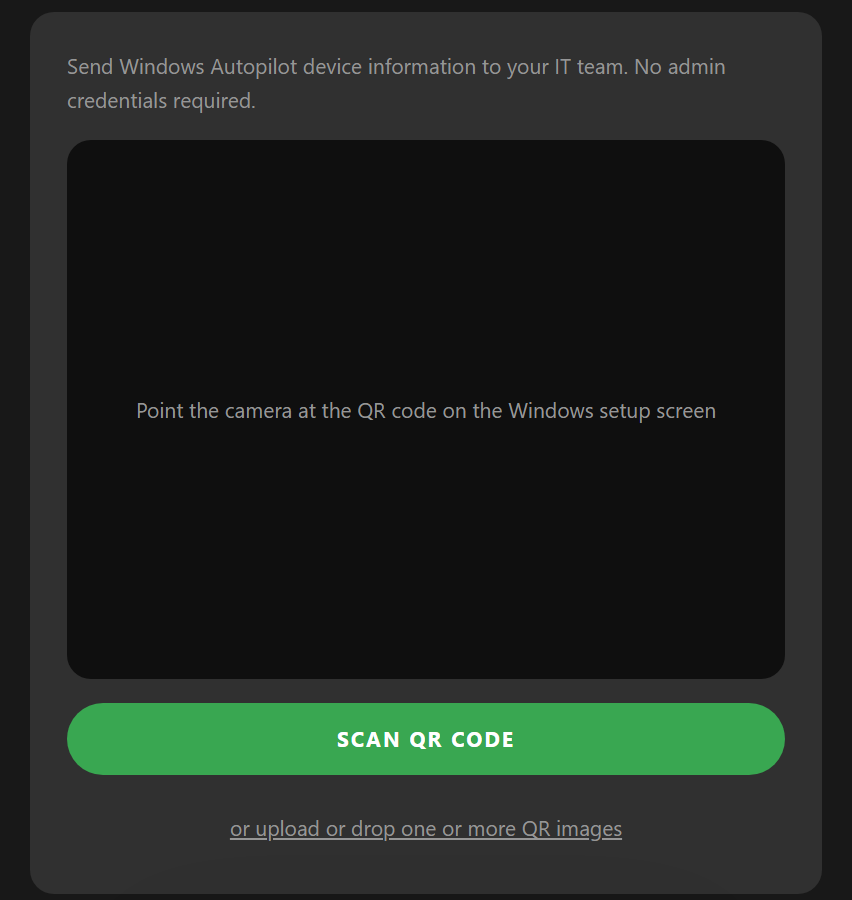
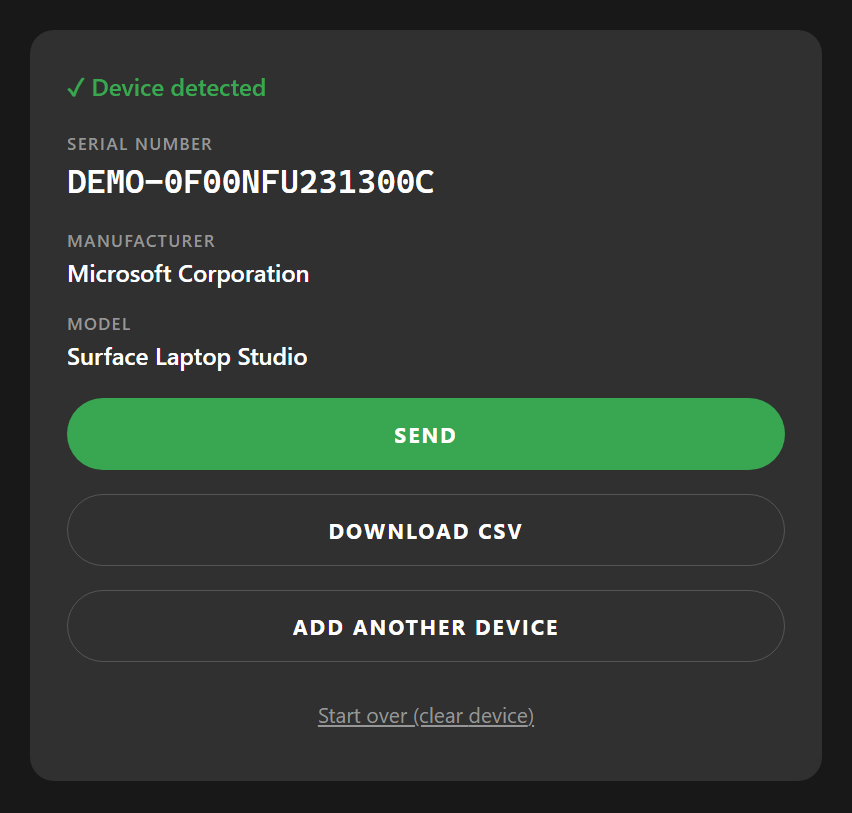

# AutopilotSnap

**Scan. Send. Deploy.**

Send Windows Autopilot device information to your IT team, straight from your phone. No admin credentials required.

**Use it now: https://autopilotsnap.msnugget.com/**

AutopilotSnap is a small web app for the person who unboxes and prepares Windows devices. You scan the QR code that Windows shows during setup, check the detected device, and send a ready-made CSV to the IT administrator. The administrator uploads that file to Intune. You never sign in to anything.

> AutopilotSnap is an independent community project by [msnugget](https://msnugget.com). It is **not** an official Microsoft product and is not affiliated with or endorsed by Microsoft.

<p>
  
  
</p>

## How to use it

**For the person preparing the device**

1. Turn on the Windows device and stop at the first setup screen (region selection). Press the **Windows key five times** to open the Autopilot menu and choose **Scan QR code**. A QR code appears on the screen.
2. Open AutopilotSnap on your phone or laptop and tap **Scan QR Code**. No camera? Take a photo or screenshot of the code and upload or drop it instead. You can add several images at once.
3. Check the serial number, manufacturer and model.
4. Tap **Send**. Your device's share sheet opens with the CSV attached; pick your mail app and your IT team's address. Use **Add another device** first if you want to send several devices in one file.

If your browser cannot share files, the CSV is downloaded and your mail app opens. In that case **attach the downloaded file yourself**; web pages cannot attach files to an email automatically.

**For the IT administrator**

Upload the CSV in the Intune admin center as a corporate device identifier: **Devices → Enrollment → Corporate device identifiers → Add → Upload a CSV file → Manufacturer, model and serial number**. Menu names can change, so check Microsoft's documentation if you don't see them.

The file has one line per device and no header row:

```
Microsoft Corporation,Surface Laptop Studio,0F00NFU231300C
```

This is the corporate-identifier route for Windows Autopilot device preparation. It is not the signed file used by Intune's *Device association*.

More answers are on the FAQ page inside the app.

## Privacy

- Everything happens in your browser: the QR code is decoded, the CSV is created, and nothing is uploaded to AutopilotSnap or anyone else.
- No backend, no accounts, no analytics, no telemetry, no cookies.
- Camera images and uploaded pictures never leave your device.
- Device data is kept in memory only and is gone when you reload the page or tap **Start over**.
- Your browser stores only your light/dark choice.
- Data leaves your browser only when you tap Send or Download CSV.

## Self-hosting

AutopilotSnap is a static website, so any static host works (Cloudflare Pages or Workers, GitHub Pages, Azure Static Web Apps, and so on). The camera needs HTTPS.

```bash
npm install
npm run build      # static site in dist/
```

For Cloudflare, connect the repository and use build command `npm run build` and deploy command `npx wrangler deploy`. `wrangler.toml` serves `dist/` as static assets; there is no server-side code.

## Contributing and development

```bash
npm install
npm run dev        # local dev server
npm run typecheck
npm test
```

Built with Vite, React and strict TypeScript. QR decoding uses [zxing-wasm](https://github.com/Sec-ant/zxing-wasm), served from the app itself. The code is organised in small modules under `src/lib`: `devicelink.ts` (QR parsing), `csv.ts`, `share.ts` and `scanner.ts`. Tests use obviously synthetic data; never commit real QR payloads or device exports.

Issues and pull requests are welcome.

## Credits and licence

Built by [Florian Salzmann](https://www.linkedin.com/in/fsalzmann/) and [Jannik Reinhard](https://www.linkedin.com/in/jannik-r/). MIT licence, see [LICENSE](LICENSE).

The initial version of this idea comes from Simon: [AutopilotQR](https://github.com/Simsen/AutopilotQR) (MIT). If you want a direct upload to Intune with sign-in, his solution does that. AutopilotSnap exists because we needed an option **without authentication**. It is an independent implementation and contains none of AutopilotQR’s Microsoft Graph or sign-in code.
